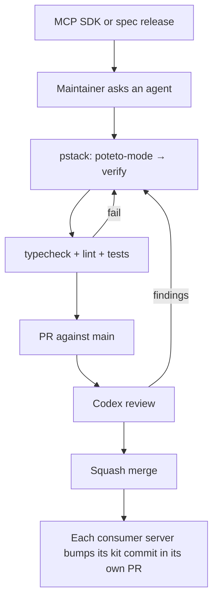

# mcp-server-kit factory

How changes to the kit are made, checked, and released. Linked from the Factory section of [AGENTS.md](../../AGENTS.md#factory).

## Workflow

## Methods and sources

| Job | Method | Project source |
| --- | --- | --- |
| Implement, verify, review | pstack's `poteto-mode` and its playbooks | The maintainer's own pstack install; nothing in this repository configures it |
| Lint | Oxlint with [@cloudflare/oxlint-config](https://github.com/cloudflare/oxlint-config), plus vendored anti-slop rules the preset doesn't cover | [oxlint.config.ts](../../oxlint.config.ts); [UPSTREAM.md](../../tools/oxlint/anti-slop/UPSTREAM.md) |
| Write the PR | workbench's `pr-writing`, with a Conventional Commits title | Commit history on `main` |

## Checks

| When | Required result | Source |
| --- | --- | --- |
| Every PR | `typecheck`, `lint`, and `test` pass locally, with the output in the PR | [package.json](../../package.json) |
| Dependency changes | `bun run audit` is clean, and the install gate in `bunfig.toml` still holds | [AGENTS.md](../../AGENTS.md#install-policy) |
| Every PR | Codex code and security review; findings fixed or answered on the PR | Codex settings for this repository |

## Project decisions

- Agents stop at a PR for the maintainer to merge. The one exception: an agent may squash-merge its own dependency or security update once its checks pass and Codex review is clean.
- The kit has no CI and no branch protection, so only these instructions hold the stopping point.
- Consumers pin the kit by git commit. A kit release reaches a server only through that server's own PR, which reviews the kit diff before bumping the lockfile.
- Rules the lint config turns off carry their reason beside them. Source type assertions carry a `SAFETY:` comment naming the check that makes them sound, in place of a ban on unsafe assertions.

## Operating evidence

- `bun run test` needs IPv6 loopback, and three token-store persistence tests fail when run as root, as in some cloud sandboxes.
- Last shaped with factory-shaping 0.4.0.
- Review the factory after five merged PRs, or after the maintainer has to step in the same way twice.
